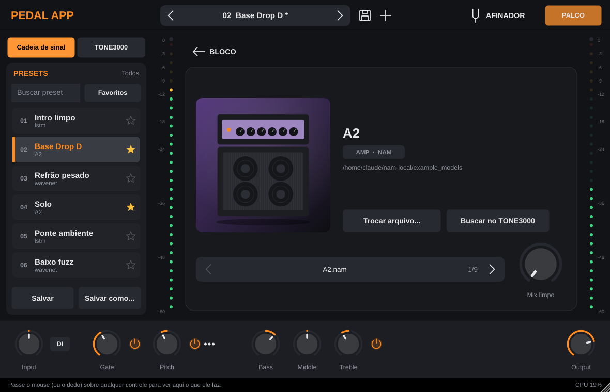
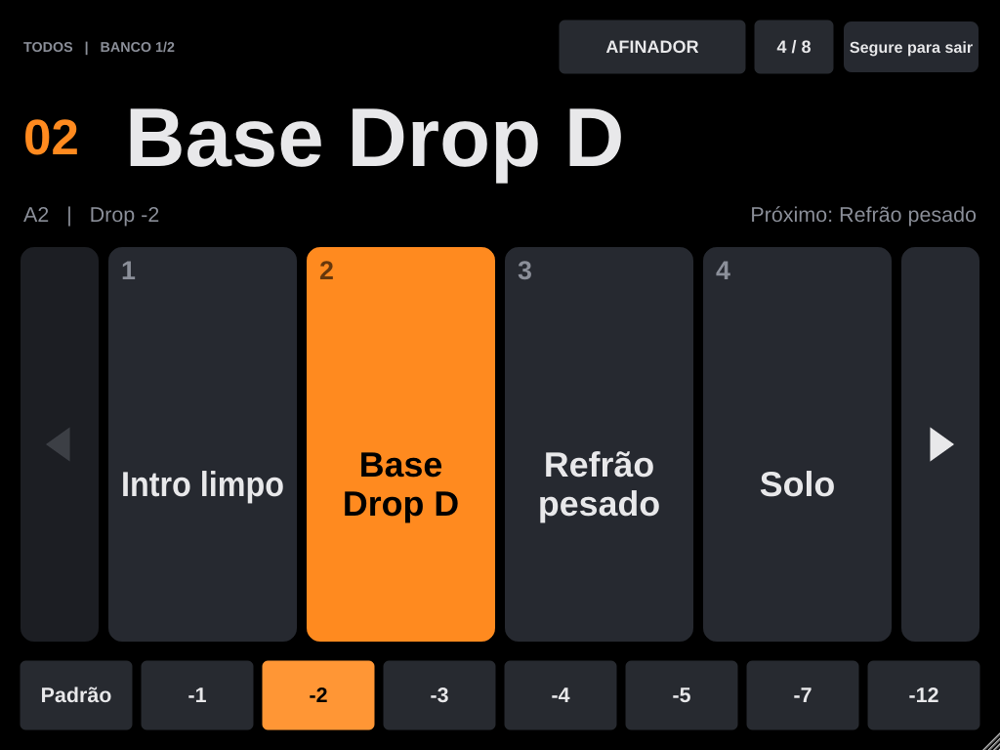
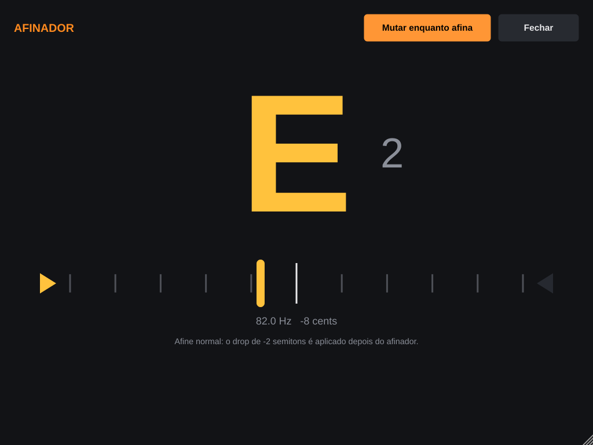

# Pedal App

Plugin e app standalone de amp/pedal para guitarra e baixo, usando capturas
[NAM](https://github.com/sdatkinson/neural-amp-modeler) (incluindo as do
[TONE3000](https://www.tone3000.com)), com drop de afinação embutido.
Primeiro roda no PC (Windows/Mac); depois o mesmo código vira app de iPad para
tocar ao vivo.


## O que já funciona

- Carregar uma captura `.nam` do computador (A1 e A2) e um IR de caixa `.wav`.
- Cadeia: entrada → gate → afinação → amp NAM → caixa → mix limpo → saída.
- Drop de afinação polifônico de +12 a −12 semitons (botões de atalho de 0 a −12).
- Troca de captura sem estalo: a nova entra com crossfade e nada é carregado na
  thread de áudio.
- **Modo de teste sem interface:** toca uma gravação limpa (DI) de guitarra ou
  baixo em loop pela cadeia, para ouvir capturas e o drop pelo fone ou pela
  caixa do computador.
- Medidor de CPU e aviso quando a captura foi treinada em outra taxa de amostragem.
- Formatos: Standalone e VST3 (Windows/Mac/Linux) e AU (Mac).

## Baixar pronto (sem compilar)

Cada PR e cada commit na `main` gera o app pronto para Windows, Mac e Linux:

1. Abra a aba **Actions** do repositório (ou, no PR, clique em **Checks**) e
   entre na execução mais recente do **Build** com ✓ verde.
2. No fim da página, em **Artifacts**, baixe **PedalApp-Windows** (precisa estar
   logado no GitHub).
3. Descompacte o `.zip`:
   - `Standalone/Pedal App.exe`: abre direto. Se o Windows mostrar "O Windows
     protegeu o computador", clique em **Mais informações → Executar assim mesmo**
     (o app não é assinado).
   - `VST3/Pedal App.vst3`: copie a pasta para `C:\Program Files\Common Files\VST3`
     para usar num DAW.

Os arquivos ficam disponíveis por 30 dias em cada execução.

## Como compilar

Precisa de **CMake 3.24+** e de um compilador C++20:

- **Mac:** Xcode (pelo App Store) e `brew install cmake`
- **Windows:** Visual Studio 2022 com "Desenvolvimento para desktop com C++"

```bash
git clone https://github.com/thalele88/pedal-app.git
cd pedal-app
cmake -S . -B build -DCMAKE_BUILD_TYPE=Release
cmake --build build --config Release --parallel
```

A primeira configuração baixa o JUCE, o NAM core e o Signalsmith Stretch, então
demora alguns minutos.

O resultado fica em `build/PedalApp_artefacts/Release/`:

- `Standalone/Pedal App` (`.app` no Mac, `.exe` no Windows) para abrir direto
- `VST3/Pedal App.vst3` para usar num DAW

No Mac, para gerar um projeto do Xcode: `cmake -S . -B build-xcode -G Xcode`.

### Teste rápido do motor

```bash
ctest --test-dir build -C Release --output-on-failure
```

Ele processa 10 segundos de áudio com as capturas de exemplo do NAM, troca de
captura no meio e confere que não sai NaN, que não fica mudo e que roda bem mais
rápido que tempo real.

## Usando no standalone

1. Em **Options → Audio/MIDI Settings**, escolha sua interface de áudio e um
   buffer de 64 ou 128 amostras.
2. O JUCE silencia a entrada na primeira vez para evitar microfonia: desmarque
   "Mute audio input" na mesma tela.
3. Na **cadeia de sinal**, toque no card **+ Adicionar amp** e escolha um `.nam`,
   e em **+ Adicionar caixa** escolha um IR (ou arraste os arquivos para a janela).
   Tocar num card já preenchido abre a tela do bloco, com setas para comparar as
   outras capturas da mesma pasta.
4. Na barra de baixo ficam os controles gerais: **Input**, **Gate**, **Pitch**
   (o drop de afinação; clique com o botão direito ou em `•••` para os atalhos),
   **Bass / Middle / Treble** e **Output**. Os botões de power desligam sem perder
   o ajuste. Os medidores nos cantos mostram o nível de entrada e de saída, e a
   barra de dicas no rodapé explica o que cada controle faz.
5. Monte o som e toque no **+** do topo (ou em **Salvar como...**) para criar um preset.



### Modo palco

O botão **PALCO** abre a tela de show: nome do preset gigante, 4 ou 8 botões
grandes por banco, drop de afinação a um toque e o afinador. No app standalone
ela ocupa a tela inteira. Os botões respondem ao encostar o dedo, e para sair é
preciso segurar o botão "Segure para sair".



Funciona também com teclado e pedais Bluetooth de virar página:
← / → ou PageUp / PageDown trocam de preset, ↑ / ↓ trocam de banco,
1 a 8 escolhem o botão do banco, **T** abre o afinador e Esc sai.

### Afinador

Botão **AFINADOR** (ou tecla **T**). Funciona do Si grave do baixo de 5 cordas
para cima, e por padrão muta a saída enquanto você afina. Ele lê a entrada antes
do drop, então afine o instrumento normal.



## Testando sem interface de áudio

1. Arrume uma gravação **DI** (guitarra ou baixo gravado limpo, direto na linha,
   sem amp nem efeito) em `.wav`, `.aif` ou `.flac`. Muitos sites de captura e
   fóruns de NAM oferecem DIs grátis para teste; qualquer faixa DI de multitrack
   também serve.
2. Abra o standalone, clique no botão **DI** ao lado do knob Input, em **Escolher arquivo...** e
   escolha o arquivo. Ele começa a tocar em loop; o mesmo botão **DI** toca e para.
3. Em **Options → Audio/MIDI Settings**, deixe a saída nos fones ou alto-falantes
   do computador. A entrada pode ficar em qualquer coisa: com o DI tocando, ela
   é ignorada.
4. Carregue uma captura no card do amp e ligue o **Pitch** na barra de baixo para
   ouvir o drop.

## Limitações conhecidas

- O drop de afinação adiciona **cerca de 30 ms** de latência quando está ligado
  (em "Padrão" não adiciona nada). É o ponto que mais precisa de teste com
  instrumento de verdade.
- Ainda não há conexão com o TONE3000, e os presets por enquanto ficam só na
  memória (somem ao fechar o app) até o sistema de presets entrar. Veja o
  roteiro em [docs/ARCHITECTURE.md](docs/ARCHITECTURE.md).

## Licenças

- [JUCE](https://juce.com): licença gratuita para uso pessoal (ou AGPLv3).
- [NeuralAmpModelerCore](https://github.com/sdatkinson/NeuralAmpModelerCore): MIT.
- [Signalsmith Stretch](https://github.com/Signalsmith-Audio/signalsmith-stretch): MIT.
- Capturas do TONE3000 pertencem aos seus criadores; respeite a licença de cada uma.
