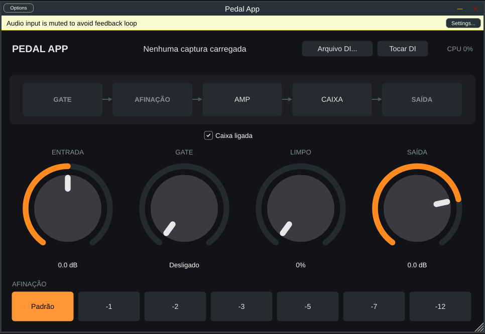

# Pedal App

Plugin e app standalone de amp/pedal para guitarra e baixo, usando capturas
[NAM](https://github.com/sdatkinson/neural-amp-modeler) (incluindo as do
[TONE3000](https://www.tone3000.com)), com drop de afinação embutido.
Primeiro roda no PC (Windows/Mac); depois o mesmo código vira app de iPad para
tocar ao vivo.



## O que já funciona

- Carregar uma captura `.nam` do computador (A1 e A2) e um IR de caixa `.wav`.
- Cadeia: entrada → gate → afinação → amp NAM → caixa → mix limpo → saída.
- Drop de afinação polifônico de +12 a −12 semitons (botões de atalho de 0 a −12),
  com dois modos:
  - **Rápido** (padrão): atraso de uns 7 a 10 ms em notas soltas, 15 ms em
    acordes e 19 ms no baixo. Ataque firme e graves limpos; em acordes cheios
    pode dar uma leve tremulada.
  - **Suave**: 18 ms fixos, sem tremulada, mas o ataque fica mais macio e as
    notas graves um pouco borradas.
- Troca de captura sem estalo: a nova entra com crossfade e nada é carregado na
  thread de áudio.
- Medidor de CPU e aviso quando a captura foi treinada em outra taxa de amostragem.
- Formatos: Standalone e VST3 (Windows/Mac/Linux) e AU (Mac).

## Como compilar

Precisa de **CMake 3.24+** e de um compilador C++20:

- **Mac:** Xcode (pelo App Store) e `brew install cmake`
- **Windows:** Visual Studio 2022 com "Desenvolvimento para desktop com C++"

```bash
git clone https://github.com/thalele88/pedal-app.git
cd pedal-app
cmake -S . -B build -DCMAKE_BUILD_TYPE=Release
cmake --build build --config Release --parallel
```

A primeira configuração baixa o JUCE, o NAM core e o Signalsmith Stretch, então
demora alguns minutos.

O resultado fica em `build/PedalApp_artefacts/Release/`:

- `Standalone/Pedal App` (`.app` no Mac, `.exe` no Windows) para abrir direto
- `VST3/Pedal App.vst3` para usar num DAW

No Mac, para gerar um projeto do Xcode: `cmake -S . -B build-xcode -G Xcode`.

### Teste rápido do motor

```bash
ctest --test-dir build -C Release --output-on-failure
```

Ele processa 10 segundos de áudio com as capturas de exemplo do NAM, troca de
captura e de modo do drop no meio e confere que não sai NaN, que não fica mudo,
que roda bem mais rápido que tempo real e que o drop afina certo nos dois modos.

### Comparar os modos do drop no seu som

Grave a guitarra ou o baixo **sem amp** (DI, `.wav`) e rode:

```bash
build/DropCompare_artefacts/Release/DropCompare minha_gravacao.wav -2
```

Ele cria `minha_gravacao_drop-2_rapido.wav` e `minha_gravacao_drop-2_suave.wav`
ao lado, já alinhados com o original, para ouvir e comparar.

## Usando no standalone

1. Em **Options → Audio/MIDI Settings**, escolha sua interface de áudio e um
   buffer de 64 ou 128 amostras.
2. O JUCE silencia a entrada na primeira vez para evitar microfonia: desmarque
   "Mute audio input" na mesma tela.
3. Clique em **AMP** para escolher um `.nam` e em **CAIXA** para escolher um IR.

## Limitações conhecidas

- O drop de afinação adiciona de **7 a 20 ms** de latência quando está ligado,
  conforme o modo e o que você toca (em "Padrão" não adiciona nada). Antes eram
  30 ms. Os números vêm de testes com sinais sintéticos; ainda falta ouvir com
  guitarra e baixo de verdade.
- Ainda não há conexão com o TONE3000, presets nem modo palco. Veja o roteiro
  em [docs/ARCHITECTURE.md](docs/ARCHITECTURE.md).

## Licenças

- [JUCE](https://juce.com): licença gratuita para uso pessoal (ou AGPLv3).
- [NeuralAmpModelerCore](https://github.com/sdatkinson/NeuralAmpModelerCore): MIT.
- [Signalsmith Stretch](https://github.com/Signalsmith-Audio/signalsmith-stretch): MIT.
- Capturas do TONE3000 pertencem aos seus criadores; respeite a licença de cada uma.
